# ☁️ Awesome Local Cloud Emulation

  

 

**A curated directory of top open-source projects, offline cloud sandboxes, and developer tools for local AWS, Azure, and Google Cloud (GCP) emulation.**

*Run cloud-native stacks offline, slash CI/CD bills, mock cloud APIs, and build resilient architectures locally.*

**Last updated: October 2026**

---

## 📑 Table of Contents

- [⚡ Overview](#-overview)
- [📊 Sector Overview & Market Dynamics](#-sector-overview--market-dynamics)
- [🏢 SaaS & Commercial Platforms](#-saas--commercial-platforms)
- [🚀 Open-Source GitHub Projects](#-open-source-github-projects)
  - [☁️ AWS Emulators](#️-aws-emulators)
  - [🔷 Azure Emulators](#-azure-emulators)
  - [🌐 Google Cloud (GCP) Emulators](#-google-cloud-gcp-emulators)
  - [🔀 Multi-Cloud & Specialized Emulators](#-multi-cloud--specialized-emulators)
- [🛠️ Key Frameworks & Migration Guide](#️-key-frameworks--migration-guide)
- [📈 Star History](#-star-history)
- [🤝 How to Contribute](#-how-to-contribute)
- [💖 Support & Sponsorship](#-support--sponsorship)
- [⚖️ Disclaimer](#️-disclaimer)

---

## ⚡ Overview

Developing and testing against public cloud providers (Amazon Web Services, Microsoft Azure, Google Cloud Platform) introduces latency, cloud API egress costs, network dependencies, and flaky CI/CD execution. **Local Cloud Emulators** simulate cloud provider APIs on your local workstation or CI runner—letting you build, test, and validate Infrastructure-as-Code (Terraform, Bicep, Pulumi) and serverless applications without requiring actual cloud accounts, internet connectivity, or unexpected cloud bills.

Following licensing shifts in early 2026—when LocalStack transitioned its Community Edition to a proprietary authentication model—the developer tooling community has expanded with an array of MIT/Apache/AGPL open-source drop-in emulators.

---

## 📊 Sector Overview & Market Dynamics

The **local cloud emulation and self-hosted cloud sandboxing** sector sits at the convergence of the **$18+ Billion Self-Hosted Cloud Platforms** market and the broader **$700+ Billion Cloud Computing & DevOps Testing** ecosystem, growing at a rapid double-digit CAGR (>11%). 

Market dynamics have historically exhibited a **winner-take-most concentration** around developer mindshare (anchored predominantly by LocalStack for AWS emulation and Moto for Python testing); however, the category has recently entered a **moderately fragmented phase**. Strict enterprise compliance constraints, developer pushback against proprietary licensing, and cost-reduction drives have stimulated depth-first, single-binary, and multi-tenant open-source alternatives across AWS, Azure, and GCP.

---

## 🏢 SaaS & Commercial Platforms

| Product | Valuation / Revenue | Starting Price | Free Tier / Trial Limits | Description |
| :--- | :--- | :--- | :--- | :--- |
| **[LocalStack](https://localstack.cloud/)** | **Valuation:** ~$100M–$250M (Series A, $25M raised) **Revenue:** ~$7M–$10M ARR | Starts at **$39/dev/month** (Base plan); $89/dev/month (Ultimate plan) | **Hobby Plan**: $0 forever (Strictly non-commercial use only, community tier service limits, requires auth token). **Free Trial**: 30-day free trial of Ultimate tier (no credit card required). | Emulates AWS locally in Docker. Features base AWS emulation, Cloud Pods state sharing, ephemeral sandboxes, and Azure in private preview. Commercial use on the free Hobby tier is prohibited; requires an account & auth token. |

*Note: No other dedicated pure-SaaS platforms exist exclusively for local cloud emulation, as the primary value proposition of these tools is local containerized or in-process execution. Paid tiers for local emulation tools represent commercial usage licenses, advanced hosted management, and state-sharing features.*

---

## 🚀 Open-Source GitHub Projects

All open-source tools below are actively maintained and sorted in descending order of GitHub community stars within their respective categories.

### ☁️ AWS Emulators

* **[LocalStack](https://github.com/localstack/localstack)**   
  **The former de facto standard, now proprietary.** Provides a fully functional local AWS cloud stack as a Docker container. Since March 2026, the Community Edition requires authentication (account + auth token), and commercial use on the free Hobby plan is prohibited. Paid plans unlock commercial use.

* **[floci](https://github.com/floci-io/floci)**   
  **The MIT-licensed LocalStack drop-in replacement.** A single static binary speaking the AWS wire protocol on port 4566. Requires no account or auth token. Automatically translates LocalStack environment variables, executes `/etc/localstack/init/` scripts, and responds on `/_localstack/health`. Employs real backend containers for Lambda, RDS (PostgreSQL/MySQL), and Valkey/ElastiCache.

* **[Moto](https://github.com/getmoto/moto)**   
  **The mature Python AWS mock.** The longest-standing open-source AWS emulator. Functions both in-process (patching botocore with zero infrastructure footprint) and as a standalone HTTP server speaking wire protocol for any programming language.

* **[MiniStack](https://github.com/ministackorg/ministack)**   
  **The multi-tenant AWS emulator.** Maps any 12-digit `AWS_ACCESS_KEY_ID` to an isolated account ID with multi-region state separation. Eases migration with LocalStack health-check compatibility, init script execution, and reset endpoints for clean CI state.

* **[fakecloud](https://github.com/faiscadev/fakecloud)**   
  **The depth-first Rust AWS emulator.** Single ~19 MB static binary (AGPL-3.0) validated against 54,000+ Smithy test variants. Supports 23 services and 1,680 operations including S3, SQS, SNS, DynamoDB, Lambda (13 runtimes), CloudFormation, EventBridge, Step Functions, and Bedrock with real cross-service triggering.

---

### 🔷 Azure Emulators

* **[Azurite](https://github.com/Azure/Azurite)**   
  **Microsoft's official Azure Storage emulator.** Open-source (JavaScript/Node.js) cross-platform emulator supporting Azure Blob, Queue, and Table storage APIs with IP-style and production-style URL schemes.

* **[floci-az](https://github.com/floci-io/floci-az)**   
  **Free, lightweight local Azure emulator suite.** Part of the Floci project family, providing local API endpoints for core Azure compute, messaging, and cloud resource primitives without telemetry or authentication hurdles.

* **[localaz](https://github.com/link-society/localaz)**   
  **Lightweight local Azure cloud emulator.** Inspired by LocalStack and localgcp, providing developer-friendly local stubs and mocks for essential Azure cloud service interactions.

* **[azlocal](https://github.com/DanielTangnes/azlocal)**   
  **Unified Azure local developer suite.** Orchestrates Azurite, Cosmos DB Linux emulator, and Service Bus emulator with Key Vault and Event Grid mocks under a single CLI (`azlocal up -d`) and local web management dashboard.

---

### 🌐 Google Cloud (GCP) Emulators

* **[floci-gcp](https://github.com/floci-io/floci-gcp)**   
  **The open-source GCP local emulator.** Free and unencumbered single-port (4588) emulator utilizing HTTP/2 ALPN negotiation. Supports Cloud Storage, Pub/Sub, Firestore, Datastore, Secret Manager, IAM, and Managed Kafka with in-memory or WAL-backed persistence.

* **[localgcp](https://github.com/slokam-ai/localgcp)**   
  **The Vertex AI-aware GCP emulator.** Single Go binary covering 14 GCP services with unique native emulation for Vertex AI (Gemini API with streaming and tool calling) backed by local Ollama, OpenAI, or Anthropic models.

* **Firebase Local Emulator Suite**  
  **Google's official local development suite.** Emulates Firebase Authentication, Cloud Firestore, Realtime Database, Cloud Storage, and Cloud Functions with an interactive browser-based UI.

---

### 🔀 Multi-Cloud & Specialized Emulators

* **[softwaremill/elasticmq](https://github.com/softwaremill/elasticmq)**   
  **Amazon SQS-compatible message queue.** High-performance Scala/Akka-based messaging system with an SQS-compatible REST interface, runnable standalone, in Docker, or embedded in unit test runners.

* **[adobe/S3Mock](https://github.com/adobe/S3Mock)**   
  **Adobe's lightweight Amazon S3 emulator.** Implements the S3 HTTP REST API for local unit and integration testing. Seamlessly packaged for Docker, Testcontainers, JUnit Jupiter, and TestNG.

* **[goccy/bigquery-emulator](https://github.com/goccy/bigquery-emulator)**   
  **Google Cloud BigQuery emulator in Go.** Standalone BigQuery API implementation allowing complex SQL validation and query execution locally without GCP credentials or billing.

* **[stackshy/cloudemu](https://github.com/stackshy/cloudemu)**   
  **Multi-cloud in-memory control surface simulator.** Emulates AWS, Azure, and GCP APIs (S3/Blob/GCS, EC2/VM, DynamoDB/Cosmos/Firestore, EKS/AKS/GKE) in Go memory with deterministic instant resets via `/_cloudemu/reset`.

* **[nrndev/pogi](https://github.com/nrndev/pogi)**   
  **All-in-one multi-cloud local emulator.** Single binary listening on one local port to simulate core AWS, Azure, and GCP services simultaneously for local CLI, SDK, and Terraform testing.

---

## 🛠️ Key Frameworks & Migration Guide

- **Migrating from LocalStack**: Consider **floci** or **MiniStack** for wire-level AWS drop-in compatibility without license keys or authentication requirements.
- **Python-First Testing**: Use **Moto** for zero-dependency, ultra-fast in-process botocore mocks.
- **Azure Testing Stacks**: Pair Microsoft's official **Azurite** with **floci-az** or **azlocal** for multi-service coverage.
- **GCP & AI Development**: Deploy **floci-gcp** for standard GCP services, and **localgcp** when testing applications with local LLMs / Vertex AI.
- **Cross-Cloud Unified CI**: Deploy **cloudemu** or **pogi** for lightning-fast unit tests requiring multi-cloud API control surfaces.

---

## 📈 Star History

---

## 🤝 How to Contribute

Contributions, bug reports, and updates are warmly welcomed! 🌟

1. 🍴 Fork the repository.
2. 🌿 Create a new feature branch (`git checkout -b feature/add-new-emulator`).
3. 📝 Add or update tools following the existing format with stars badge, factual descriptions, and official links.
4. 🚀 Commit your changes (`git commit -m 'Add new cloud emulator tool'`).
5. 📬 Push to the branch and open a Pull Request.

---

## 💖 Support & Sponsorship

If this curated list helps you reduce cloud bills, streamline local testing, or accelerate development, please consider showing your support:

- ⭐ **Star this repository** to help other developers discover it!
- 🍴 **Fork and share** it with your engineering team or community.
- ☕ **Buy me a coffee / Sponsor the project** on the [GitHub Sponsor Dashboard](https://github.com/sponsors/ishandutta2007)! Every sponsorship fuels continuous maintenance and curation.

---

## ⚖️ Disclaimer

- This is an independent, community-curated directory — not affiliated with or endorsed by Amazon Web Services, Microsoft Azure, Google Cloud, or LocalStack Inc.
- Emulation fidelity varies: in-process mocks (e.g. Moto) mock API interfaces and schemas, whereas containerized wire-protocol servers (e.g. floci, MiniStack, fakecloud) execute actual backend processes (Postgres, Redis, Lambda runtimes).
- Security policies (IAM) and persistent state mechanisms differ across emulators; refer to individual project documentations before relying on them for compliance validation.
